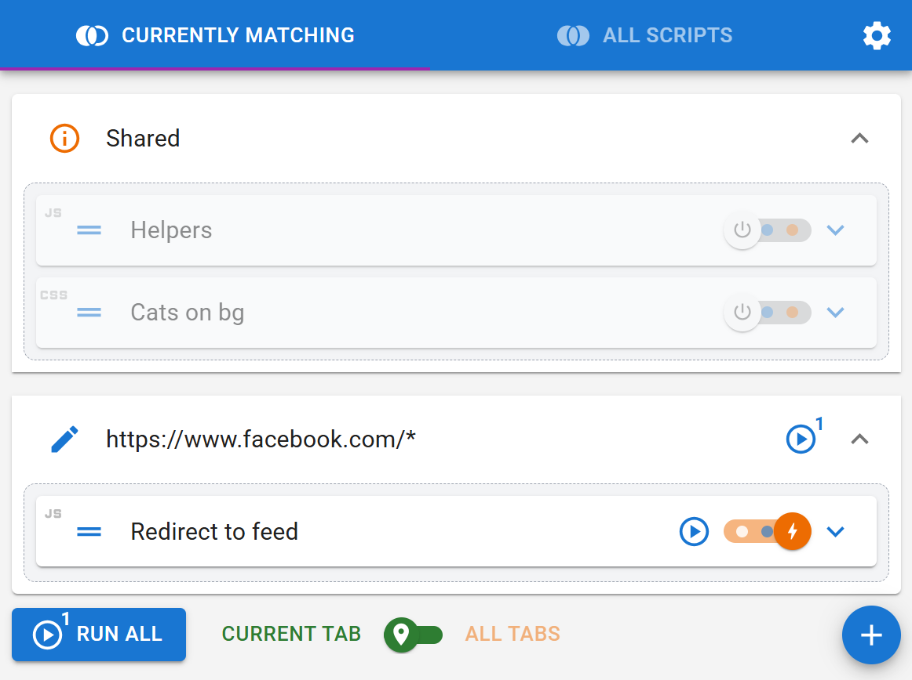

InjectCode
==========

A Chrome extension to store your own JavaScript and CSS and run it on the pages you choose.

> Version 1 was available on the
[Chrome Web Store](https://chrome.google.com/webstore/detail/injectcode/flhghpihapijancfhnicbnjifdodohpi), but it has
been taken down because it wasn't migrated to Manifest V3 in time. Version 2 is that migration and is in the process of
being published there again. Until then, install it from a release zip as described below.

> **InjectCode is a tool for developers.** It runs code you write on the websites you choose, with full access to those
> pages, including any site you are logged in to. Don't use it unless you understand what your scripts do, and never add
> code from a source you don't trust.

## Features

- JavaScript and CSS scripts grouped by URL match pattern, such as `https://example.com/*`
- Run a single script, every script of a URL, or all matching scripts at once
- Run all on the current tab only or on every open tab
- *Always on* scripts that run automatically whenever a matching page loads
- Shared scripts that run before every URL's own scripts
- Separate views for the scripts matching the current tab and for all your scripts
- Drag to reorder, which also sets the order the scripts run in
- Export and import your scripts as a backup file

## Privacy

InjectCode has no server and sends nothing anywhere. Your scripts and settings stay in your Chrome profile.
See [PRIVACY.md](PRIVACY.md) for exactly what is stored, what the extension reads and why it needs each permission.

## Getting started

Requires Chrome 138 or newer. Every release on the [Releases page](https://github.com/jaakkytt/InjectCode/releases)
has the exact zip submitted to the Chrome Web Store, so you can see precisely what the extension contains:

1. Download the zip from the release and extract it to a folder.
2. Open `chrome://extensions` and turn on *Developer mode*.
3. Click *Load unpacked* and select the extracted folder.
4. The InjectCode options page opens. **Read it and follow its setup first.** It walks you through the settings
   InjectCode needs to run your scripts, such as **Allow User Scripts**, and explains how scripts are run and what to do
   when they don't. You can reopen it any time from the gear icon in the popup.

An extension installed this way doesn't update automatically. To update, repeat these steps with the newer release.

To build it yourself instead, follow [development/README.md](development/README.md) and load the resulting `dist/`
folder the same way.

## Upgrading from 1.x

Version 2 is a rewrite for Chrome Manifest V3, and scripts saved by version 1 are not carried over. Scripts that relied
on the bundled jQuery or the global `InjectCode`, `openTab(url)` and `XhrMonitor` helpers need to be rewritten without
them. See the [changelog](CHANGELOG.md) for all changes.

## Privacy

Your scripts are stored only in your browser profile. They are not synced between devices and nothing is sent
anywhere. Uninstalling the extension deletes them, so export a backup first if you want to keep them.

## Issues and license

Report bugs in [GitHub issues](https://github.com/jaakkytt/InjectCode/issues). InjectCode is released under the [MIT License](LICENSE),
third-party attributions are listed in [ATTRIBUTIONS.md](ATTRIBUTIONS.md).
